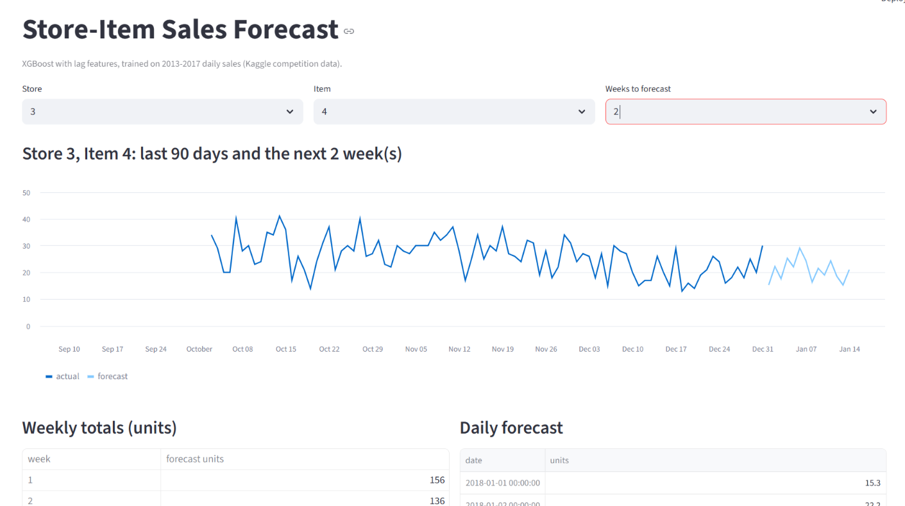

# Store-Item Demand Forecasting

Forecasts daily unit sales for the next 4 weeks, using 5 years of daily data (2013-2017) for 10 stores x 50 items (913,000 rows).

**Data:** Kaggle competition data (store item demand forecasting). Holiday effects were removed by the organisers.
   
## Approach

- **Baselines:** (1) repeat the last 7 days, (2) average of each weekday over the last 4 weeks.
- **Model:** XGBoost on lag features (28, 35, 42 and 364 days), a 28-day rolling mean, weekday, month and day of year. All lags are at least 28 days, so the model only uses data that would be available when forecasting 4 weeks ahead (no leakage).
- **Evaluation:** time-ordered rolling backtest. Train on the past, test on the next 28 days, repeat for 4 windows (2017-09-11 to 2017-12-31). No random splits.
- **Metrics:** MAE (units per day) and sMAPE (%), reported against both baselines.

## Results

### Store 1, Item 1 (average of 4 windows)

| | MAE | sMAPE |
|---|---|---|
| Repeat last week | 5.60 | 27.35% |
| Average of last 4 weeks | 4.87 | 24.05% |
| XGBoost | **3.94** | **20.22%** |

XGBoost beat both baselines in all 4 windows. Its MAE is about 19% lower than the best baseline (average of last 4 weeks).

### All 10 stores, 500 series, one model with store and item as features (average of 4 windows)

| | MAE | sMAPE |
|---|---|---|
| Repeat last week | 10.07 | 19.89% |
| Average of last 4 weeks | 9.75 | 18.74% |
| XGBoost | **6.00** | **12.39%** |

XGBoost beat both baselines in all 4 windows. Its MAE is about 38% lower than the best baseline on average. The gap is widest in the 2017-12-04 to 2017-12-31 window (MAE 5.40 vs 12.81 and 15.81), where the baselines do much worse; in the other three windows the reduction against the best baseline is smaller (about 14% to 25%).

### Error by weekday (store 1, item 1, last window)

Largest XGBoost errors were on Saturday (6.62) and Tuesday (5.94). Wednesday and Thursday were the smallest (1.70 and 1.82).

### Tuning

Optuna (20 trials, scored on time-ordered windows only) did not improve the model: final-window MAE was 3.72 tuned vs 3.60 with the default settings. The default settings were kept.

## MCP tool

`forecast_server.py` exposes `forecast_sales(store, item, weeks)` as an MCP tool. It validates inputs (store 1-10, item 1-50, weeks 1-4), trains on that series' history and returns daily forecasts and weekly totals. `test_forecast_mcp.py` checks that the tool is listed, returns a valid forecast, and returns an error message for an invalid store.

## Streamlit app

`app.py` is a small page for trying the forecast. Pick a store (1-10), an item (1-50) and 1 to 4 weeks. It shows the last 90 days of actual sales with the forecast, the weekly totals and the daily forecast. It uses the same model and features as the MCP tool. Run it from the project folder with `streamlit run app.py`.

## Limitations

- Kaggle competition data with holiday effects removed, so results may not carry over to real store data.
- The backtest covers only 4 windows, all from September to December 2017. Other times of year were not tested.
- Tuning was done only on store 1, item 1. The all-stores model uses fixed settings and was not tuned.
- The MCP tool and the Streamlit page train a separate model for the requested series on each new selection, which is slow for production use. Neither uses the all-stores model.
- Only the MCP tool's behaviour (listing, valid call, invalid input) was tested, not its accuracy across all stores and items.
- No price, promotion or stock-out information is used.
- sMAPE for a single item is high (about 20%) because daily sales are small numbers, so a gap of a few units is a large percentage.
- No other model families (for example ARIMA or neural networks) were compared.

## Files

- `demand.ipynb`: baselines, features, backtest, error analysis, all-stores model, tuning
- `forecast_server.py`: MCP server
- `test_forecast_mcp.py`: MCP client test
- `app.py`: Streamlit page
- `train.csv`: data